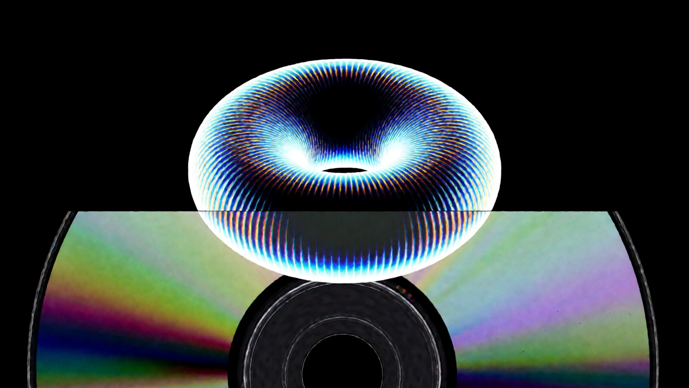
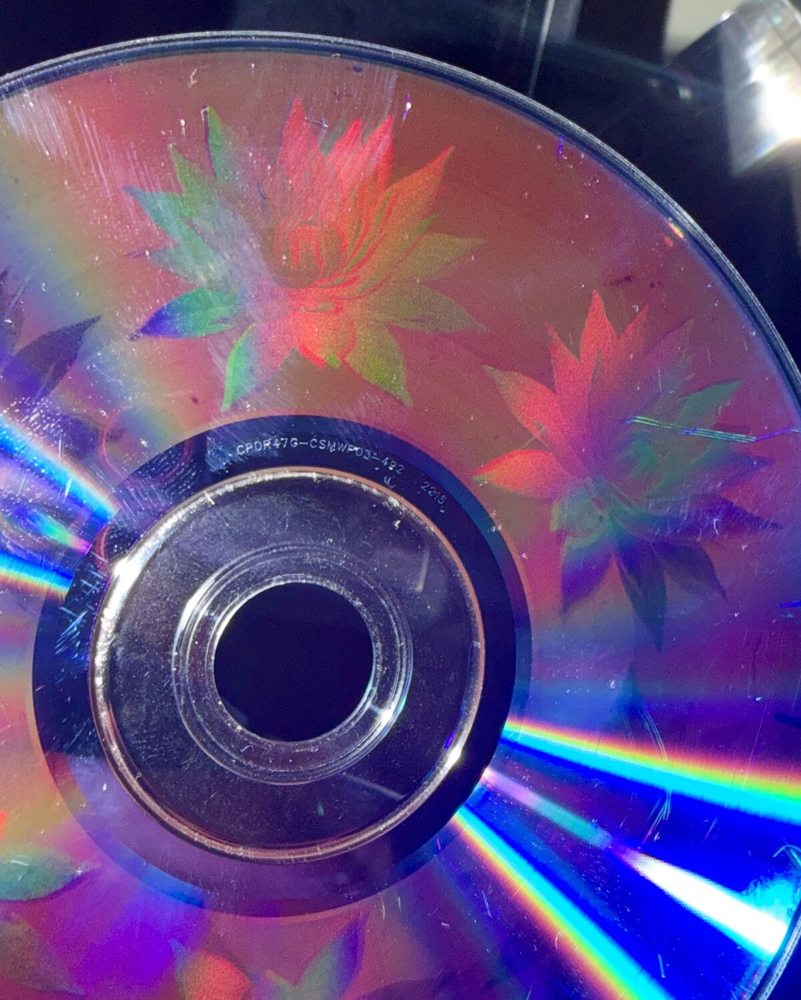
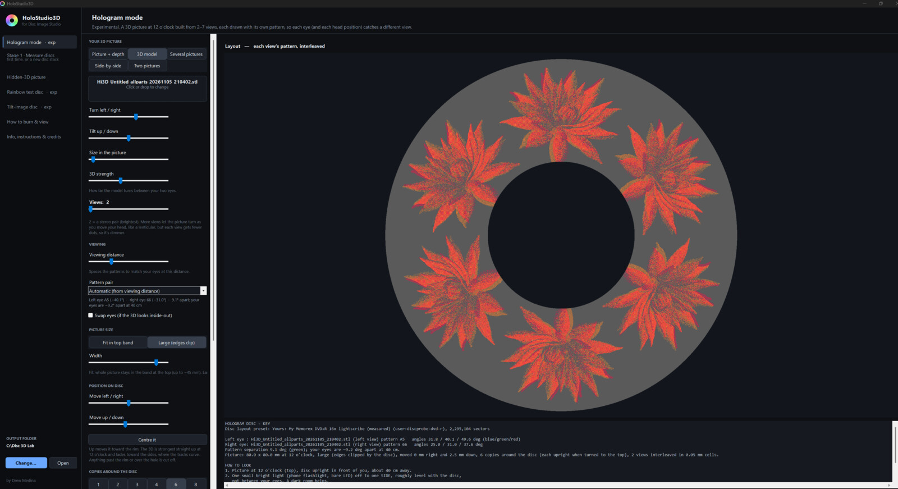

<p align="center">
  
</p>

# HoloStudio3D

**Burn 3D holograms into DVDs** from your own pictures, depth maps and 3D models.
By [Drew Medina](https://drewmedina.com).

**[Download the latest release](../../releases/latest)** (Windows 10/11, 64-bit): extract the zip,
open `HoloStudio3D-App` and run `HoloStudio3D.exe`.

<p align="center">
  
  <br><em>A burned Verbatim DVD+R disc under a single light.</em>
</p>

> This repository also contains **Disc Image Studio (English Edition)**, the disc-imaging app
> HoloStudio3D is built on, originally by [JiaFeiMiao-K-Cat](https://github.com/JiaFeiMiao-K-Cat/DiscImageStudio).
> Its own readme is [README-DiscImageStudio.md](README-DiscImageStudio.md).

An experimental companion tool for Disc Image Studio (English Edition), by Drew Medina. It burns a 3D
**hologram** into the data side of a DVD: a picture that shows depth when you look at the disc
under a single light, with each eye seeing a slightly different view. You make it from your own
pictures, a picture plus its depth map, or a 3D model.

## Making a hologram

Open **Hologram mode** (the top of the sidebar). Choose what to show, set a few sliders, and click
*Make hologram disc*. You get an .iso to burn, a key that says how to look at it, and a
`-views.png` showing every view the app built, so you can check them before burning.

<p align="center">
  
  <br><em>Hologram mode: a 3D model, 2 views, large picture, 6 copies around the disc, with a measured disc preset.</em>
</p>

**How it works.** The app draws your picture from several viewpoints (the *views*) and weaves them
together in a fine grid at 12 o'clock. Each view is written with its own data pattern, and each
pattern throws light off the disc at its own angle. Your eyes are a few degrees apart, so each one
catches a different view, and your brain fuses them into depth, the same idea as a lenticular
print or a glasses-free 3D screen. With more than two views, moving your head brings in the
neighbouring views and the picture turns.

**From a picture and a depth map** (*Picture + depth*). Use the same pair you'd use for a
lenticular: a picture and a grayscale depth map of the same size, white = near (tick *Depth map
uses black = near* if yours is the other way round). Depth maps from Convert3D or any depth tool work. The app
builds every view itself by shifting each part of the picture by its depth.
- *3D strength* is how far near and far parts shift between your eyes; 2-4 % is a good start.
- *Pop-out point* sets which depth sits on the disc surface: nearer parts float in front of the
  disc, farther parts sink behind it.

**From a 3D model** (*3D model*, .obj or .stl; convert GLB or PLY to OBJ first). The app renders
the model as a lit gray shape on black from each view's angle, so the views line up exactly.
- *Turn* and *Tilt* set which side faces you; *Size* zooms in or out.
- *3D strength* here is how many degrees the model turns between your eyes; 4-8° looks natural.

**From your own pictures.**
- *Several pictures*: 2 to 7 views of the same scene, taken or rendered from a camera moving
  sideways in even steps (lenticular frames, or a turntable render). Drop them all at once; they
  are ordered left to right by file name, so name them frame1, frame2, ...
- *Side-by-side* (one picture with the left view on the left, such as Convert3D output) or *Two
  pictures* (a separate left and right view) make a 2-view hologram.

**Views.** 2 views is a classic stereo pair and the brightest. 3-4 views let the picture turn as
you move, but each view gets a smaller share of the disc, so it's dimmer. Up to 7 are possible.

**What works best.** One simple, bold subject with clear edges and strong contrast. Dark areas
stay dark on the disc, so a subject on a black background (which models get automatically) stands
out best. Start with the picture in the top band and the *Fine* dither; then try *Large*, moving
it, or *Copies around the disc* to fill more of the disc.

**Before your first hologram**, do *Stage 1 · Measure discs* once for your stack of discs, so the
picture lands where it should instead of streaking. Then burn the .iso at your drive's slowest
speed, hold the disc upright with the picture at the top and one small light off to the side, and
close one eye, then the other: each eye should see its own view light up.

## Also in the app

- **Hidden-3D picture:** a "Magic Eye" style random-dot stereogram, saved as a plain black/white
  PNG to burn with Disc Image Studio, on CD or DVD.

## Installing

HoloStudio3D runs on Windows 10 or 11 (64-bit). There are two ways to get it running.

**Option A: ready-built download** (if you were given the `HoloStudio3D-App` folder as a zip)
1. Download the zip.
2. Right-click it, choose *Extract All…*, and extract it somewhere simple, such as `C:\HoloStudio3D`.
3. Open the extracted `HoloStudio3D-App` folder and double-click `HoloStudio3D.exe`.

Nothing else to install. If Windows shows "Windows protected your PC", click *More info*, then
*Run anyway* (the app isn't code-signed).

**Option B: build it from the setup package** (the full zip with the source)
1. Download the setup zip and extract it somewhere simple, such as `C:\HoloStudio3D-Setup`.
2. Install the **.NET 10 SDK** from Microsoft (dotnet.microsoft.com, *Download .NET 10*, the
   Windows x64 SDK installer). You only need to do this once.
3. In the extracted folder, double-click `Build-English.bat`. Stay online the first time: it
   downloads a private copy of Python for Stage 1. It takes a few minutes.
4. When it's done, the `HoloStudio3D-App` folder opens. Double-click `HoloStudio3D.exe`.

Either way, keep everything in `HoloStudio3D-App` together (the `disc-probe` folder is needed for
Stage 1). To uninstall, delete the folder; your settings are in `%LOCALAPPDATA%\Disc3DLab`.

You'll also want a disc-burning program that can write an .iso image, such as ImgBurn (free) or
Windows' own *Burn disc image* (right-click the .iso).

## Using the app

Double-click `HoloStudio3D.exe` and the HoloStudio3D window opens. It's a normal native Windows
program (Windows Forms): no browser, no Edge, no console box, and nothing goes online (the links on the Info page open your default browser only when you click them).

The window has these sections in the sidebar:
- **Hologram mode** (at the top): a 3D picture built from 2 to 7 views. Use a picture + depth map,
  a 3D model (.obj/.stl), several pictures (lenticular frames), a side-by-side 3D picture, or a
  left and right picture; set your viewing distance, see the layout, then make the disc.
- **Stage 1 · Measure discs (first time, or a new disc stack):** measures your own discs with disc-probe and installs the result as a
  preset, so pictures land straight instead of streaked. Do this once per spindle of discs.
- **Hidden-3D picture:** live preview as you move the sliders. Drop a depth picture or 3D model
  onto the box, then *Save PNG*.
- **Rainbow test disc:** the ring layout and key, then *Make test disc image*, with a progress bar
  and a Cancel button.
- **Tilt-image disc:** drop up to 4 pictures onto the slots (or click one), pick a pattern for
  each, see the layout, then make the disc.
- **How to burn & view.**
- **Info, instructions & credits:** setup and first-disc steps, credits with links to
  drewmedina.com and both GitHub projects, the license, and *Reset all settings to defaults*.

**Remembers your settings:** every slider, switch, list and name, the pictures you loaded, the
page you were on and the window size are saved as you go (in
`%LOCALAPPDATA%\Disc3DLab\settings.txt`) and come back next time. A picture that has since been
moved or deleted is simply left empty.

**Output folder:** use *Change…* at the bottom of the sidebar (or *Choose…* next to any save box)
to pick where files go, and *Open* to view the folder. Until you pick one, files go to
`C:\HoloStudio3D` at the top of C: (if you already have `C:\Disc 3D Lab` or another folder from an earlier name, it keeps using that). Windows doesn't let normal programs save files directly in
`C:\` itself, so it uses a folder there. The folder you pick, your disc preset and the last
section you used are remembered. Everything is also available from
the command line (`HoloStudio3D.exe --help`).

---

## Stage 1: measure your discs (do this first)

A picture comes out stretched and streaky when the app's idea of the disc's spiral doesn't match
your discs. Even discs of the same brand differ slightly from batch to batch. Stage 1 runs
[disc-probe](https://github.com/Ashley-QwQ/disc-probe) by Ashley-QwQ, built in. It times how your
drive reads a burned disc to measure the spiral exactly, with no photos and no clicking points.

1. **Your drive:** pick the burner. *Practice run* uses disc-probe's simulated drive to show the
   flow with no disc. A practice run can't install a preset.
2. **Make measuring disc image** writes `measuring-disc.iso` (random data) to your output folder.
   Burn it with ImgBurn at the lowest speed, then put it back in the drive. You need one per
   spindle, and you can't put a picture on it afterwards, so keep it.
3. **Check drive** (1–3 min). You want `CAV` and low jitter. If disc-probe suggests another speed,
   it appears as a button under *Suggested next steps*.
4. **Measure geometry** (about 5 min). The verdict appears at the top. If it suggests a correction
   or another speed, click the suggested step. When a suggested command uses `--correction
   correction.json` and that file isn't there yet, HoloStudio3D writes it from your measurement
   first, then runs the command.
5. **Install as a preset:** put a *blank* disc from the same spindle in, click **Read blank disc**
   to get its sector count, name the preset, then **Install preset into Disc Image Studio**. It's
   written to Disc Image Studio's preset list (backed up first). Restart Disc Image Studio and pick
   it. HoloStudio3D selects it straight away in every section.

**If the measurement stops partway** ("a whole-turn count is probably wrong"), usually because of a
flaw or gap on the measuring disc, a **Measure without the trouble spot** button appears. It reruns
slower and leaves out the stretch where it failed, using `--ranges`. You can also type any
disc-probe command into **Any disc-probe command** at the bottom of the page, e.g.
`geo --drive E: --speed 3324 --reps 32 --ranges 71840-1863264`, or `geo -h` to list every option.

disc-probe only sends read commands to the drive, and it refuses anything that writes. All burning
is still done by you, with ImgBurn or Windows. It runs on a private copy of Python that
`Build-English.bat` downloads into the `disc-probe` folder next to `HoloStudio3D.exe`, so nothing is
installed on your system. Keep that folder with the EXE. Its results are kept in
`%LOCALAPPDATA%\Disc3DLab\disc-probe`.

## 1. Hidden-3D picture

**Sources:** a built-in shape (torus, rings, spheres, ripple, star), a depth-map picture
(white = near), or a 3D model (`.obj` / `.stl`, e.g. exported from Hi3D Studio or IdolMesh).

```
HoloStudio3D stereogram --demo torus --out torus.png
HoloStudio3D stereogram --mesh model.obj --yaw 30 --out model.png
HoloStudio3D stereogram --depth depth.png --dot 0.25 --out cd-version.png
```

**Burn it:** open the PNG in Disc Image Studio, fill the 120 mm disc with it, and use 2 tone
levels so every dot stays black or white.

**See it:** hold the disc 30–40 cm away and look *through* it, as if at something far behind it.
The two guide dots at the top turn into three, and the shape floats in depth. The centre hole
leaves a gap in the image, so the built-in shapes are designed to sit in the readable ring.

Tips:
- `--dot 0.25` or larger for CD-R, which burns softer than DVD.
- `--separation 12` makes it easier to lock onto; `16` gives more depth.
- `-depth.png` is saved next to the output so you can check the shape.

I checked the generator by decoding its output back into depth with a computer, and the shapes
come back correctly. Whether it reads well *on a disc* depends on how sharp your burns are.

---

## 2. Diffraction discs (experimental)

### The idea

On a DVD, each data byte becomes a 16-bit pattern of marks along the track. A long run of the
same byte repeats that pattern, which makes it a diffraction grating along the track. I worked
out the repeating pattern for every byte from the DVD standard's modulation tables (ECMA-267
EFMPlus). Some bytes give one strong, clean period:

| Byte | Period | Throws green light at about |
|---|---|---|
| A5 | 0.85 µm | 40° |
| 66 | 1.07 µm | 31° |
| B9 | 1.42 µm | 23° |
| 92 | 2.13 µm | 15° |

These are the same four bytes Disc Image Studio uses as its DVD gray levels. Alternating two
bytes gives longer periods and smaller angles (7°, 4°, 2°).

**Not proven yet.** The bytes the Lab writes are checked exactly. What hasn't been tested is how
strongly a real burner and dye turn them into visible colour. That's what the test disc is for.

### Step 1: test disc

```
HoloStudio3D diffraction-test --out diffraction-test.iso
```

This writes a full 4.7 GB DVD image with 12 rings of textures, plus a key (`-key.txt`) and a
false-colour layout map (`-map.png`). Each ring alternates every 45° between the test texture and
a random "no grating" reference.

**Burn it as a disc image:** right-click the .iso > *Burn disc image*, or use ImgBurn > *Write
image file to disc*. It has no file system on purpose, so Explorer won't open it.

**Look at it:** use one small bright light in a dark room. Turn the disc so a test segment is at
12 or 6 o'clock, start at the mirror reflection, and tilt slowly left and right. A working ring
shows a clean colour band, at roughly the angle in the key, that the random segments next to it
don't. The big rainbow running out from the centre is the normal DVD track rainbow, so ignore it.

### Step 2: Hologram mode (3D, 2-7 views)

Hologram mode used to be called *Stereo pair*. The command is now `hologram` (`stereo-pair`
still works).

```
HoloStudio3D hologram --image picture.png --depthmap depth.png --views 5 --strength 3 --out holo.iso
HoloStudio3D hologram --model statue.obj --views 4 --turn 6 --yaw 20 --out holo.iso
HoloStudio3D hologram --frames f1.png,f2.png,f3.png,f4.png --out holo.iso
HoloStudio3D hologram --sbs my-3d-sbs.png --distance 40 --large --width 110 --out holo.iso
HoloStudio3D hologram --left l.png --right r.png --pair B9,92 --out holo.iso
```

Each data pattern sends its light out at its own angle. The Lab draws each view with its own
pattern and interleaves them in a fine grid (0.05 mm cells by default) at 12 o'clock, where the
tracks run left-right. Your eyes see the disc from angles a few degrees apart (about 9° at
40 cm), so each eye catches a different view, the way your 3D display or a lenticular aims each
image at one eye.

- **Views (2-7):** 2 is a classic stereo pair, one view per eye, and the brightest. With more
  views the Lab picks evenly spaced patterns (there are 7 clean ones), so moving your head left and
  right brings in the neighbouring views and the picture turns, like a lenticular. Each view gets
  1/N of the dots, though, so more views means a dimmer picture. All the views are saved next to
  the .iso as `-views.png` (left-most first) so you can check them.
- **Picture + depth map** (the same pair you'd use for a lenticular): the Lab builds every view
  itself by shifting each pixel by its depth. *3D strength* sets the shift between your two eyes
  (% of picture width); *pop-out point* sets which depth sits on the disc surface, so nearer parts
  float in front and farther parts sink behind. White = near (tick the box if yours is black =
  near).
- **3D model** (.obj or .stl): the Lab renders a lit gray picture of the model from each view's
  angle, on black. *Turn* and *Tilt* set the starting angle, *Size* zooms, and *3D strength* is
  how many degrees the model turns between your two eyes (default 6°). Export GLB/PLY models to
  OBJ first.
- **Several pictures:** drop 2-7 pictures at once (lenticular frames). Each is one view, ordered
  left to right by file name, so name them frame1, frame2, ...
- **Side-by-side picture** (Convert3D output works), or separate left and right pictures (2 views).
  Tick *squeezed* for half-width side-by-side and *cross-eyed* if the right view is on the left.
- **Test tiles:** five tiles at 6 o'clock, printed upside down so they read upright when you
  turn the disc. Each holds an **L** for the left eye and an **R** for the right, in the same spot,
  using a different pattern pair. Close one eye at a time: the tile where each eye sees only its own
  letter is the pair that works on your discs. With 2 views, choose it under *Pattern pair* and burn again.
- **Picture size:** *Fit in top band* keeps the whole picture in the band at 12 o'clock
  (up to 80 mm wide, 30 mm tall), where the 3D works best. *Large (edges clip)* (`--large`) makes
  it up to 116 mm wide, centred on that band. The hub, the hole and the rim cut it off, and the
  3D gets weaker toward 3 and 9 o'clock, where the tracks curve away.
- **Position on disc:** *Move left / right* (up to 40 mm) and *Move up / down* (up to 30 mm;
  up is toward the rim) slide the picture around, or `--move-x MM` / `--move-y MM` on the
  command line. *Centre it* puts it back. The 3D is strongest straight up at 12 o'clock and fades
  toward the sides, where the tracks curve; anything past the rim or over the hole is cut off.
- **Copies around the disc (1, 2, 3, 4, 6 or 8):** fills the empty part of the disc. The disc is
  cut into equal slices and each slice gets a copy turned to face out from the centre, so whichever
  copy you turn to 12 o'clock is upright, with its tracks running left-right, and shows the 3D.
  Each slice is about 82 / 71 / 58 / 41 / 31 mm wide (for 2 / 3 / 4 / 6 / 8 copies) at the middle
  of the band; a wider picture is cut at its slice edges. Copies can't all show at once: away from
  12 and 6 o'clock the tracks run the wrong way for your eyes. With 2 copies, *Keep the bottom copy
  upright* (experimental) leaves the 6 o'clock copy unturned, since the tracks there also run
  left-right, so both may show at the same time. The L/R test tiles are drawn on top of the bottom
  copy; untick them for a clean disc. Command line: `--copies N`, `--upright-bottom`.
- **Dither detail:** *Fine* (0.05 mm cells, the default), *Normal* (0.1 mm) or *Coarse* (0.2 mm),
  or `--detail MM`. Grays are now spread with error diffusion in both directions, so the grain is
  much finer than before. If a Fine burn looks faint or washed out, try Normal.
- **Viewing:** picture at the top, about your chosen distance away, with one small light off to
  the side (not between your eyes). With more than 2 views, move your head slowly left and right.
  If the depth looks inside-out, tick *Swap eyes*.

This is experimental: the bytes are verified exactly, but it's untested on a real burn.

### Disc layout presets

`--preset` picks the DVD layout from the app's presets (`HoloStudio3D presets` lists them). Pick
your disc brand if it's listed; otherwise use `dvd-5-120mm`. The preset only affects where
shapes land on the disc, not the grating angles.


## Help evolve it

HoloStudio3D is an experiment, and there's a lot still to learn about how far a home DVD burner
can be pushed toward real holograms. Help from the community is very welcome:

- **Burn a disc and share what you see.** Photos of hologram, rainbow test and tilt discs, good or
  bad, with your drive, disc brand and settings, show what works where. Open an
  [issue](../../issues) with your results.
- **Report problems.** If something fails, open an issue and paste the log from the app.
- **Improve it.** Ideas, better patterns, viewing tricks, fixes and pull requests are all welcome.

## Special thanks

HoloStudio3D wouldn't exist without these two projects and their authors:

- **[JiaFeiMiao-K-Cat](https://github.com/JiaFeiMiao-K-Cat)** and the contributors to
  **[Disc Image Studio](https://github.com/JiaFeiMiao-K-Cat/DiscImageStudio)**, the disc-imaging
  engine and app this is built on.
- **[Ashley-QwQ](https://github.com/Ashley-QwQ)**, author of
  **[disc-probe](https://github.com/Ashley-QwQ/disc-probe)**, which measures your drive and discs
  in Stage 1 so pictures land where they should.

Thank you both for sharing your work as open source.
